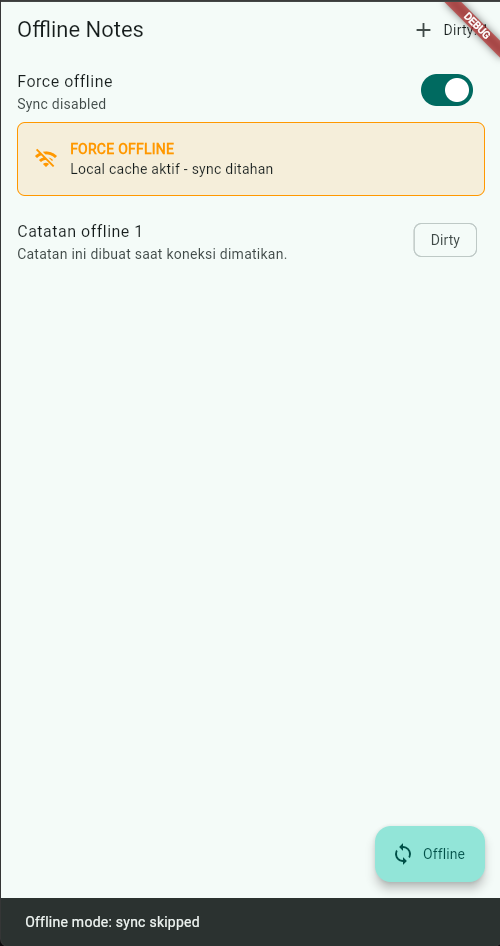
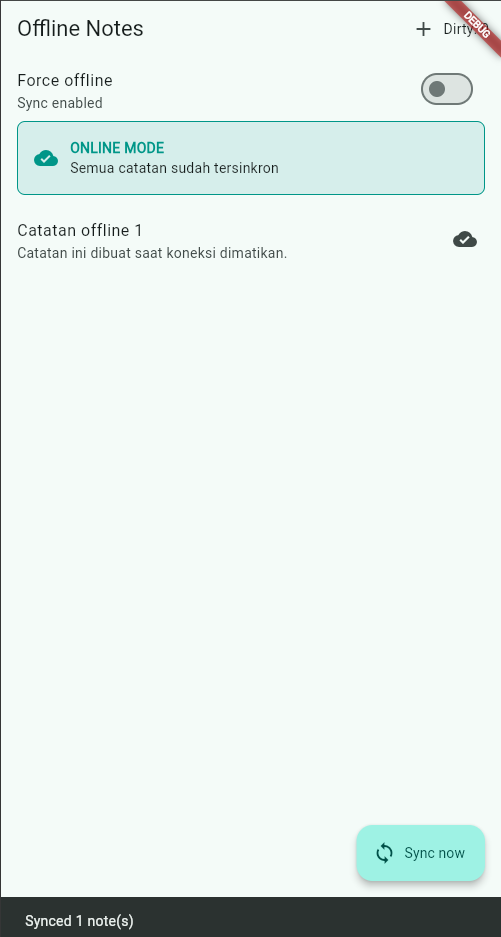

# Minggu 8 — Mid Project Review & Code Review

Praktikum ini **tidak membuat project baru**. Yang dikerjakan adalah mereview
project Minggu 5–7 dengan disiplin kolaborasi: branch, commit konvensional,
Pull Request kecil, review, dan bukti mesin hijau.

| Data | Keterangan |
|:-----|:-----------|
| Nama | Marta Prama Daniswara |
| NIM | 244107020205 |
| Kelas | TI-3D |
| Project yang direview | `05-week-5-local-storage-offline-first/week5_offline_notes` |
| Pembanding arsitektur | `07-week-7-clean-architecture/campus_notify` |

---

## Status Paruh Semester

| Aspek | Status | Catatan |
|:------|:------:|:--------|
| Aplikasi berjalan | ✅ | Perilaku identik dengan akhir Minggu 5: tambah catatan, toggle force offline, sync, badge dirty |
| `flutter analyze` | ✅ | `No issues found!` pada week5 dan week7 (Flutter 3.47.2) |
| `dart format` | ✅ week5 / ⚠️ week7 | week5 bersih; week7 masih 15 berkas (issue lanjutan) |
| `flutter test` | ✅ | week5 **23 test**, week7 **14 test**, semua lulus |
| Struktur feature-first | ✅ week7 | Tiga grep sterilitas lolos; week5 sengaja tetap layer-first |
| PR kecil + commit jelas | ✅ | 9 PR, semua < 350 baris perubahan dan sudah merged |
| Review ditindaklanjuti | ✅ | 2 blocker + 3 saran, semua punya bukti |
| CI menolak PR kotor | ✅ | `.github/workflows/ci.yml`, toolchain dipin |
| Dokumentasi AI review | ✅ | `docs/ai-review-*.md` |
| Toolchain reproducible | ✅ | Flutter dipin `3.47.2` + `pubspec.lock` di-commit |

**Kesimpulan:** fondasi layak dilanjutkan. Tidak ada pekerjaan besar yang
tertunda; yang tersisa adalah perbaikan kecil yang sudah tercatat sebagai issue.

---

## Peta Issue / PR

| Issue | Judul | PR | Branch | Status |
|:------|:------|:---|:-------|:-------|
| [#5](https://github.com/artsybyte/244107020205-mobile-course/issues/5) | Suite test gagal (timeout 30 s) + format | [#1](https://github.com/artsybyte/244107020205-mobile-course/pull/1) | `fix/notes-green-suite` | ✅ closed |
| [#6](https://github.com/artsybyte/244107020205-mobile-course/issues/6) | Validasi judul kosong | [#4](https://github.com/artsybyte/244107020205-mobile-course/pull/4) | `feat/notes-validation` | ✅ closed |
| [#7](https://github.com/artsybyte/244107020205-mobile-course/issues/7) | Kegagalan simpan tanpa umpan balik | [#4](https://github.com/artsybyte/244107020205-mobile-course/pull/4) | `feat/notes-validation` | ✅ closed |
| [#8](https://github.com/artsybyte/244107020205-mobile-course/issues/8) | Belum ada CI | [#2](https://github.com/artsybyte/244107020205-mobile-course/pull/2), [#11](https://github.com/artsybyte/244107020205-mobile-course/pull/11) | `chore/ci`, `fix/ci-pin-toolchain` | ✅ closed |
| [#9](https://github.com/artsybyte/244107020205-mobile-course/issues/9) | Dokumentasi mid review | [#3](https://github.com/artsybyte/244107020205-mobile-course/pull/3), [#12](https://github.com/artsybyte/244107020205-mobile-course/pull/12) | `docs/week8-mid-review`, `docs/week8-corrections` | ✅ closed |
| [#10](https://github.com/artsybyte/244107020205-mobile-course/issues/10) | Koneksi DB per operasi + migrasi `material_ui` | — | — | 🔵 follow-up (open) |

> Nomor issue dan PR berbagi urutan yang sama di GitHub. Karena PR #1–#4 dibuat
> lebih dulu, issue baru otomatis mendapat nomor **#5–#10**.

### Daftar Pull Request

| PR | Judul | Branch → base | Terkait | CI | Status |
|:---|:------|:--------------|:--------|:---|:-------|
| [#1](https://github.com/artsybyte/244107020205-mobile-course/pull/1) | fix(notes): hijaukan suite test dan terapkan dart format | `fix/notes-green-suite` → `develop` | Closes #5 | ❌ merah (SDK drift) | ✅ merged |
| [#2](https://github.com/artsybyte/244107020205-mobile-course/pull/2) | chore(ci): jalankan analyze, format, dan test pada pull request | `chore/ci` → `develop` | Closes #8 | ❌ merah (SDK drift) | ✅ merged |
| [#3](https://github.com/artsybyte/244107020205-mobile-course/pull/3) | docs: artefak Mid Project Review Minggu 8 | `docs/week8-mid-review` → `develop` | Closes #9 | ❌ merah (SDK drift) | ✅ merged |
| [#4](https://github.com/artsybyte/244107020205-mobile-course/pull/4) | feat(notes): validasi judul kosong + tindak lanjut review | `feat/notes-validation` → `develop` | Closes #6, #7 | ✅ hijau | ✅ merged |
| [#11](https://github.com/artsybyte/244107020205-mobile-course/pull/11) | chore(ci): pin Flutter 3.47.2 agar analyze tidak merah | `fix/ci-pin-toolchain` → `develop` | Closes #8 | ✅ hijau | ✅ merged |
| [#12](https://github.com/artsybyte/244107020205-mobile-course/pull/12) | docs: koreksi nomor issue/PR dan catat temuan SDK drift | `docs/week8-corrections` → `develop` | — | ✅ hijau | ✅ merged |
| [#13](https://github.com/artsybyte/244107020205-mobile-course/pull/13) | docs: catat penggunaan merge commit dan penutupan issue manual | `docs/merge-and-issue-notes` → `develop` | — | ✅ hijau | ✅ merged |
| [#14](https://github.com/artsybyte/244107020205-mobile-course/pull/14) | docs(week8): sinkronkan status issue/PR dan tambah bukti CI | `docs/week8-final-sync` → `develop` | — | ✅ hijau | ✅ merged |
| [#15](https://github.com/artsybyte/244107020205-mobile-course/pull/15) | docs(week8): ringkas bukti CI agar tidak cepat basi | `docs/week8-ci-summary` → `develop` | — | ✅ hijau | ✅ merged |

PR #1–#3 sempat merah bukan karena kodenya, melainkan karena `channel: stable`
bergeser ke Flutter 3.50. Setelah toolchain dipin di PR #11, semua run berikutnya
hijau. Rinciannya ada di [`docs/review-checklist.md`](docs/review-checklist.md)
bagian 2b.

### Bukti CI Hijau

Workflow: [`.github/workflows/ci.yml`](../.github/workflows/ci.yml) — dua job,
`week5_offline_notes` dan `week7_campus_notify`.

Sejak toolchain dipin di PR #11, **tidak ada lagi workflow run yang gagal** —
seluruh run pada setiap PR dan setiap push ke `develop` berstatus `success`.
Sebelum itu, 5 run pertama (#1–#5) merah di langkah `flutter analyze` karena
`channel: stable` bergeser ke Flutter 3.50.

Langkah yang dijalankan per job: `flutter pub get --enforce-lockfile`,
`flutter analyze`, `dart format --set-exit-if-changed` (khusus week5), dan
`flutter test`. Toolchain dipin ke Flutter **3.47.2**, sehingga PR tidak bisa
merah/hijau hanya karena rilis SDK baru.

Daftar run lengkap:
<https://github.com/artsybyte/244107020205-mobile-course/actions>

Alur: `issue → branch → commit kecil → PR "Closes #N" → review → merge → branch dihapus`.

Dua catatan teknis yang ditemukan saat eksekusi:

1. **Merge commit, bukan squash.** Semua PR di-merge dengan *merge commit* agar SHA
   commit di branch tetap utuh, sehingga branch lain yang di-rebase di atasnya
   (`feat/notes-validation` di atas `fix/notes-green-suite`) tidak perlu di-rebase
   ulang. Squash tetap disarankan bila commit perantara berantakan.
2. **Issue tidak tertutup otomatis.** Keyword `Closes #N` hanya menutup issue bila
   PR di-merge ke *default branch* (`main`). Karena PR masuk ke `develop`, issue
   #5–#9 ditutup manual dengan komentar yang menyebut PR penyelesaiannya. Untuk
   otomatisasi penuh, `develop` perlu dijadikan default branch atau issue ditutup
   saat rilis ke `main`.

Detail lengkap issue, body PR, dan komentar review ada di
[`docs/pr-issue.md`](docs/pr-issue.md).

---

## Fitur Utama Aplikasi

`week5_offline_notes` — catatan kampus yang tetap bisa dipakai tanpa jaringan.

1. **Tambah catatan offline** — disimpan ke SQLite dengan `dirty = 1`, langsung
   tampil dari cache lokal.
2. **Force offline** — toggle yang menahan proses sync agar skenario offline bisa
   didemokan secara deterministik.
3. **Antrean dirty** — badge `Dirty: n` menunjukkan jumlah catatan menunggu sync.
4. **Sync now** — simulasi upload (delay 1 detik) lalu `markAllSynced()`; hanya
   dipanggil setelah "server" menjawab sukses.
5. **Validasi judul** *(baru di Minggu 8)* — judul kosong/spasi ditolak dengan
   pesan inline; judul di-`trim` sebelum disimpan.
6. **Umpan balik error** *(baru di Minggu 8)* — kegagalan simpan muncul sebagai
   SnackBar, bukan exception senyap.

---

## Stack Teknologi

| Lapisan | Teknologi |
|:--------|:----------|
| UI | Flutter 3.47, Material 3 |
| State | Riverpod 3 (`FutureProvider`, `NotifierProvider`) |
| Navigasi | `go_router` 16 |
| Storage | `sqflite` (tabel `notes`, `cached_posts`) + `shared_preferences` (tema) |
| Networking | `dio` 5 (cache-first posts) |
| Test | `flutter_test`, `sqflite_common_ffi` (SQLite in-memory) |
| CI | GitHub Actions + `subosito/flutter-action` |

---

## Cara Menjalankan

```bash
# 1. masuk ke project
cd 05-week-5-local-storage-offline-first/week5_offline_notes

# 2. ambil dependency
flutter pub get

# 3. jalankan
flutter run
```

Skenario demo 5 menit:

1. Tekan `+`, biarkan judul kosong, tekan `Save` → muncul
   **"Judul tidak boleh kosong"** dan dialog tetap terbuka.
2. Isi judul `Belanja`, tekan `Save` → catatan muncul, badge `Dirty: 1`.
3. Aktifkan `Force offline` → panel berubah `FORCE OFFLINE`.
4. Tekan tombol sync → SnackBar `Offline mode: sync skipped`.
5. Matikan `Force offline`, tekan `Sync now` → badge `Dirty: 0`.

### Bukti mesin hijau

```bash
flutter analyze
# Analyzing week5_offline_notes...
# No issues found! (ran in 2.3s)

dart format --output=none --set-exit-if-changed lib test
# Formatted 27 files (0 changed)
# exit code 0

flutter test
# 00:01 +23: All tests passed!
```

Pada `07-week-7-clean-architecture/campus_notify`:

```bash
flutter analyze   # No issues found!
flutter test      # 00:00 +14: All tests passed!
```

### Kesesuaian dengan Definisi Selesai Codelab

| Poin codelab | Status | Bukti |
|:-------------|:------:|:------|
| Aplikasi berjalan identik dengan akhir Minggu 7 | ✅ | Screenshot di bawah; alur tambah catatan, force offline, sync, badge dirty tetap sama |
| Tiga pemeriksaan mesin hijau (`analyze`, `dart format`, `test`) | ✅ | Blok perintah di atas + job CI `week5_offline_notes` |
| Minimal 1 PR kecil di-merge via review | ✅ | 9 PR merged (#1–#4, #11–#15); terkecil 1 berkas, terbesar 8 berkas / +308 −51 |
| README memuat status paruh semester + peta issue/PR | ✅ | Bagian [Status Paruh Semester](#status-paruh-semester) dan [Peta Issue / PR](#peta-issue--pr) |
| Dokumentasi AI review (prompt, output awal, usulan vs keputusan) | ✅ | `docs/ai-review-prompt.md`, `docs/ai-review-initial-output.md`, `docs/ai-review-vs-keputusan.md` |
| Struktur folder `docs/`, `README.md`, `screenshots/` | ✅ | Lihat [Struktur Folder](#struktur-folder) |

---

## Hasil / Screenshot

<table>
  <tr>
    <td align="center">
      <br>
      <b>Sebelum sync</b><br>
      Force offline aktif, <code>Dirty: 1</code>, sync ditahan.
    </td>
    <td align="center">
      <br>
      <b>Sesudah sync</b><br>
      Online mode, catatan tersinkron, <code>Dirty: 0</code>.
    </td>
  </tr>
</table>

---

## Struktur Folder

```
08-week-8-mid-project-review/
├── README.md                          # dokumen ini
├── docs/
│   ├── review-checklist.md            # tabel commit + checklist kesiapan + 3 grep
│   ├── branching.md                   # model branching & aturan commit
│   ├── pr-issue.md                    # issue, body PR, komentar review
│   ├── ai-review-prompt.md            # prompt yang dipakai
│   ├── ai-review-initial-output.md    # output awal AI (5 temuan)
│   └── ai-review-vs-keputusan.md      # usulan vs keputusan + bukti
└── screenshots/
    ├── 01-sebelum-sync.png
    └── 02-sesudah-sync.png
```

---

## Refleksi

### 1) Beda "LGTM" buta dengan approve yang bertanggung jawab

LGTM buta adalah menyetujui tanpa checkout, tanpa menjalankan test, tanpa
membaca jalur error. Approve yang bertanggung jawab berarti reviewer sudah
menjalankan `flutter analyze`, `dart format`, `flutter test`, lalu mencoba
fitur secara manual sebelum menyetujui.

Risikonya nyata: di PR ini, suite test ternyata **merah** sejak awal
(`TimeoutException after 0:00:30`). Reviewer yang hanya melihat diff akan
menganggap semuanya baik-baik saja, lalu bug yang sama lolos ke `develop` dan
menjadi "normal" di minggu berikutnya.

### 2) Kapan komentar wajib *request changes*, kapan cukup saran

**Request changes** bila menyangkut kebenaran atau arah dependensi yang makin
mahal diperbaiki nanti: test merah, dependency rule rusak (`WidgetRef` di data
layer), data pengguna bisa hilang, atau jalur error tanpa penanganan.

**Cukup saran** bila sifatnya peningkatan yang tidak menghalangi merge:
ekstraksi widget untuk keterbacaan, tambahan test integrasi, penamaan yang lebih
jelas. Di PR ini R1 dan R2 saya tandai blocker, R3–R5 cukup saran.

### 3) Bagian review AI yang saya tolak atau sederhanakan

Saya menolak saran migrasi penuh ke feature-first Clean Architecture. Alasannya
ada di [`docs/ai-review-vs-keputusan.md`](docs/ai-review-vs-keputusan.md):
di luar lingkup PR, sudah dikerjakan di project Minggu 7, dan untuk project 6
berkas pola itu menjadi over-engineering.

Saya juga menolak sebagian temuan "dead branch" pada validator. Klaimnya benar
untuk jalur UI, tetapi menyebutnya dead code melewatkan fakta bahwa validator
adalah kontrak aturan bisnis yang diuji langsung. Yang saya lakukan bukan
menghapus salah satu, melainkan menuliskan alasan desainnya di kode.

### 4) Satu hal konkret yang saya perbaiki setelah review

Memindahkan `syncNotesFromProvider(WidgetRef ref)` dari `lib/data` ke
`lib/pages`. Dampaknya: `git grep -n "WidgetRef" -- lib/data` kini kosong, data
layer bisa dipakai tanpa Flutter, dan orkestrasi (invalidate provider) berada di
tempat yang benar. Efek sampingnya, saya juga menemukan bahwa
`NoteRepository` membuka koneksi database baru di setiap operasi — dicatat
sebagai Issue #10 alih-alih ditambal diam-diam di PR yang sama.
