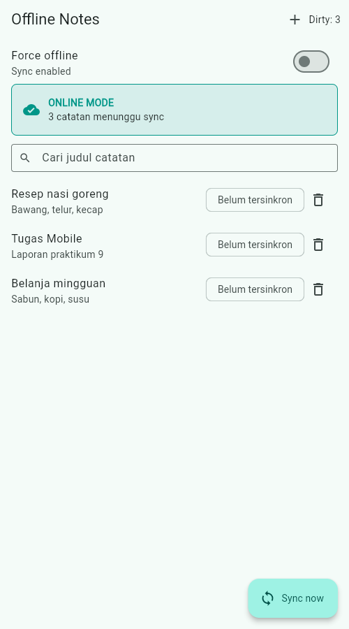
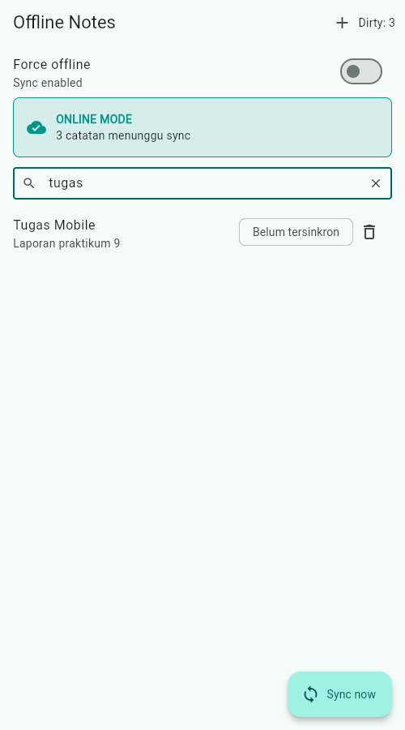
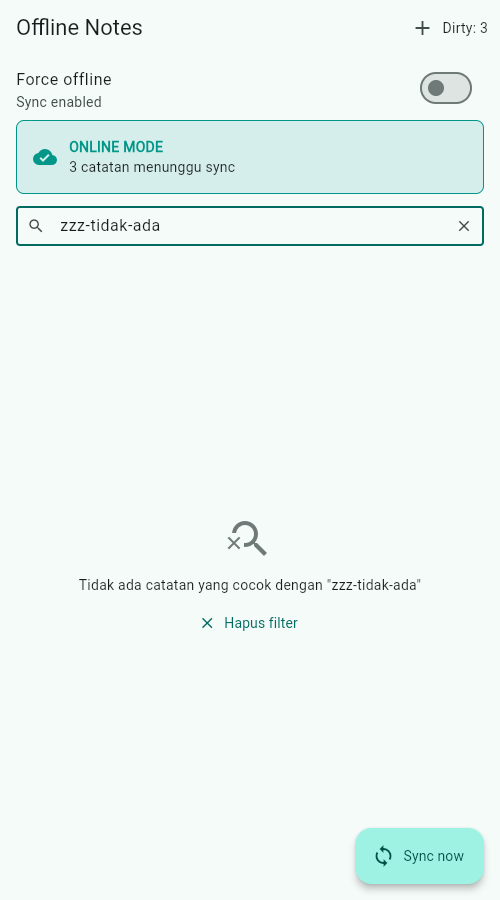
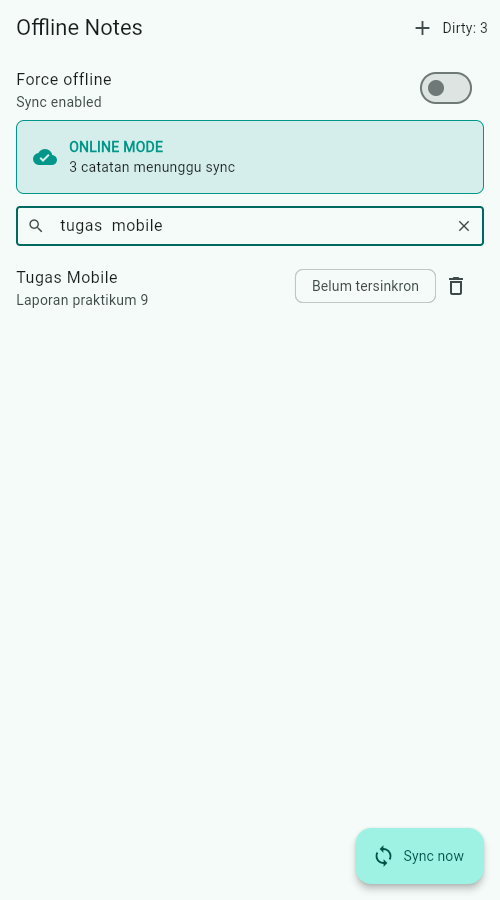

# Minggu 9 — AI-Assisted Development / Vibe Coding

Praktikum ini **tidak membuat project baru**. Satu fitur kecil ditambahkan
dengan bantuan AI ke project yang sudah lolos review Minggu 8, lalu seluruh
siklusnya diverifikasi dan didokumentasikan.

| Data | Keterangan |
|:-----|:-----------|
| Nama | Marta Prama Daniswara |
| NIM | 244107020205 |
| Kelas | TI-3D |
| Project | `05-week-5-local-storage-offline-first/week5_offline_notes` |
| Fitur | Pencarian judul catatan + empty state |
| Issue | [#16](https://github.com/artsybyte/244107020205-mobile-course/issues/16) |
| PR fitur | [#17](https://github.com/artsybyte/244107020205-mobile-course/pull/17) (merged) |
| PR perbaikan hasil review AI | [#18](https://github.com/artsybyte/244107020205-mobile-course/pull/18) (merged) |

---

## Fitur yang Ditambahkan

1. **Kolom pencarian judul** di atas daftar catatan.
2. **Pencocokan toleran**: huruf besar/kecil diabaikan, spasi tepi dibuang,
   spasi beruntun dirapatkan.
3. **Dua empty state berbeda**:
   - belum ada catatan → `Belum ada catatan`;
   - filter tidak menemukan apa pun → `Tidak ada catatan yang cocok dengan "…"`
     + tombol **Hapus filter**.
4. **Aturan filter di `lib/core/note_search.dart`** — fungsi murni, tanpa
   import Flutter, diuji langsung sebagai unit test.

### Hasil di layar

<table>
  <tr>
    <td align="center">
      <br>
      <b>Daftar catatan</b><br>
      Tiga catatan, badge <code>Dirty: 3</code>.
    </td>
    <td align="center">
      <br>
      <b>Pencarian cocok</b><br>
      Query <code>tugas</code> menyisakan satu catatan.
    </td>
  </tr>
  <tr>
    <td align="center">
      <br>
      <b>Empty state</b><br>
      Query <code>zzz-tidak-ada</code> + tombol hapus filter.
    </td>
    <td align="center">
      <br>
      <b>Spasi ganda</b><br>
      <code>tugas&nbsp;&nbsp;mobile</code> tetap menemukan catatannya.
    </td>
  </tr>
</table>

Screenshot diambil dari aplikasi yang benar-benar berjalan (`flutter build web`
+ Chrome DevTools Protocol), bukan mockup.

---

## Prompt yang Dipakai

```
Peran : senior Flutter dev
Konteks: project week5_offline_notes, layer-first (core/data/pages/widgets),
         Riverpod 3, sqflite, data cache-first. Judul catatan ada di
         Note.title (String), daftar sudah dimuat lewat notesProvider.
Tugas : tambah pencarian judul catatan + empty state yang membedakan
         "belum ada catatan" dan "hasil filter kosong".
Batas : jangan ubah arsitektur, jangan panggil SQLite dari widget,
         maksimal 80 baris kode produksi, sertakan test.
Output: kode + minimal 1 test sukses + 1 test gagal + cara uji manual.
```

Prompt lengkap, konteks yang ditempel, dan output awal AI (apa adanya) ada di
[`docs/ai-log.md`](docs/ai-log.md).

---

## Hasil Verifikasi AI

| # | Temuan | Keputusan | Bukti |
|:-:|:-------|:---------:|:------|
| 1 | `contains(query, caseSensitive: false)` — method fiktif | ✅ diperbaiki | `flutter analyze` → `undefined_named_parameter` |
| 2 | Filter ditulis di dalam `build()` | ✅ direfactor | `git grep "\.where(" -- lib/pages` → kosong setelah refactor |
| 3 | `query.isEmpty` tanpa trim/kapitalisasi | ✅ diperbaiki | 4 test merah |
| 4 | Test memanggil `filterNotes` yang tidak ada | ❌ ditolak | gagal kompilasi |
| 5 | Pencarian lewat SQL `LIKE` di repository | ❌ ditolak | koneksi DB per ketikan (issue #10), memutus cache-first |
| 6 | Spasi ganda pada query tidak cocok (pass 2) | ✅ diperbaiki | test merah → PR #18 |
| 7 | Empty state generik berparameter | ❌ ditolak | satu pemakai nyata, abstraksi belum perlu |

**Rekap:** 4 diterima dengan bukti, 3 ditolak dengan alasan tertulis.
Detail: [`docs/keputusan-ai.md`](docs/keputusan-ai.md).

---

## Stack Teknologi

| Lapisan | Teknologi |
|:--------|:----------|
| UI | Flutter 3.47, Material 3 |
| State | Riverpod 3 (`FutureProvider`, `NotifierProvider`) |
| Navigasi | `go_router` 16 |
| Storage | `sqflite` (tabel `notes`, `cached_posts`) |
| Test | `flutter_test`, `sqflite_common_ffi` |
| CI | GitHub Actions, Flutter dipin `3.47.2` |

---

## Cara Menjalankan

```bash
cd 05-week-5-local-storage-offline-first/week5_offline_notes
flutter pub get
flutter run
```

Skenario demo 3 menit:

1. Tambah catatan `Tugas Mobile`, `Belanja mingguan`, `Resep nasi goreng`.
2. Ketik `tugas` di kolom pencarian → hanya `Tugas Mobile` tampil.
3. Ketik `tugas  mobile` (dua spasi) → tetap tampil (bukti normalisasi).
4. Ketik `zzz-tidak-ada` → empty state + tombol **Hapus filter**; tekan → daftar
   kembali lengkap.
5. Kosongkan kolom → semua catatan tampil.

### Bukti mesin hijau

```bash
flutter analyze
# Analyzing week5_offline_notes...
# No issues found! (ran in 2.4s)

dart format --output=none --set-exit-if-changed lib test
# Formatted 31 files (0 changed) in 0.12 seconds.
# exit code 0

flutter test
# 00:06 +36: All tests passed!
```

CI: run #21, #22, #23 semuanya `success` di kedua job
(`week5_offline_notes`, `week7_campus_notify`).

---

## Struktur Folder

```
09-week-9-ai-assisted-development/
├── README.md                     # dokumen ini
├── lib/                          # salinan berkas fitur (sumber kanonik di week5)
│   ├── note_search.dart          # lib/core/note_search.dart
│   ├── notes_search_field.dart   # lib/widgets/notes_search_field.dart
│   └── notes_page.dart           # lib/pages/notes_page.dart
├── docs/
│   ├── ai-log.md                 # prompt, output awal AI, 6 langkah verifikasi
│   ├── keputusan-ai.md           # tabel terima/tolak + alasan + bukti
│   └── verifikasi.md             # keluaran analyze/format/test + uji manual
└── screenshots/
    ├── 01-daftar-catatan.png
    ├── 02-hasil-pencarian.png
    ├── 03-empty-state.png
    └── 04-spasi-ganda.png
```

> **Catatan soal `lib/`:** isi folder ini adalah **salinan** dari berkas yang
> benar-benar dipakai aplikasi. Sumber kanonik tetap di
> `05-week-5-local-storage-offline-first/week5_offline_notes/` pada commit
> `d5ebbe1` (merge PR #18). Salinan dibuat agar folder portofolio minggu 9 bisa
> dibaca berdiri sendiri tanpa membuka project Minggu 5.

---

## Refleksi

### 1) Halusinasi AI yang ditemukan dan cara membuktikannya

AI menulis `title.contains(query, caseSensitive: false)`. Terlihat wajar — Dart
punya `String.contains`, dan "abaikan kapitalisasi" adalah permintaan yang
umum. Buktinya bukan opini: `flutter analyze` langsung menolak dengan
`undefined_named_parameter` karena `contains` hanya menerima satu argumen
`Pattern`. Perbaikan yang benar bukan menambal dengan regex di tempat yang
sama, tetapi menormalkan kedua sisi perbandingan di satu fungsi.

Halusinasi kedua lebih halus: test AI memanggil `filterNotes` sementara fungsi
yang diusulkan bernama `searchNotes`. Kalau test tidak dijalankan, berkas itu
tampak benar.

### 2) Prompt mana yang paling membantu

Formula 5 slot dengan **batas eksplisit** ("jangan panggil SQLite dari widget",
"maks 80 baris") jauh lebih berguna daripada "buatkan search notes yang keren".
Batasan itulah yang membuat output awal bisa langsung dinilai: filter yang
mendarat di `build()` melanggar batas yang saya tulis sendiri, jadi
pelanggarannya kelihatan, bukan soal selera.

Yang saya ubah dari prompt pertama: menambahkan potongan `Note` dan
`notesProvider` yang nyata. Tanpa itu, AI mengarang field (`Note.content`) yang
tidak ada.

### 3) Refactor yang dilakukan pada kode AI

Memindahkan filter dari `build()` ke `lib/core/note_search.dart` sebagai fungsi
murni. Dampaknya terukur: `git grep -n "\.where(" -- lib/pages` kosong, dan
aturan pencarian kini punya 10 unit test yang berjalan dalam hitungan milidetik
tanpa widget tree.

### 4) Keputusan terima/tolak yang paling sulit

Menolak saran `NoteRepository.searchNotes()` dengan SQL `LIKE`. Secara
permukaan saran itu terdengar lebih "Clean Architecture" — aturan data di data
layer. Yang membuat saya menolak adalah membaca kode yang sudah ada:
`NoteRepository` membuka koneksi di setiap method. Untuk pencarian real-time,
saran itu berarti satu koneksi SQLite per huruf yang diketik. Argumen arsitektur
kalah oleh bukti di kode sendiri.

### 5) Beda `vibe coding` dengan AI-assisted development

Vibe coding berhenti di langkah 2 (generate). AI-assisted berhenti di langkah 6
(explain). Selisihnya terlihat di sesi ini: output awal AI gagal `analyze`, gagal
4 test, dan punya satu bug logika yang hanya muncul saat diuji dengan query
nyata. Tanpa langkah verify–test–refactor, semuanya akan masuk ke `develop`
sebagai "fitur selesai".
