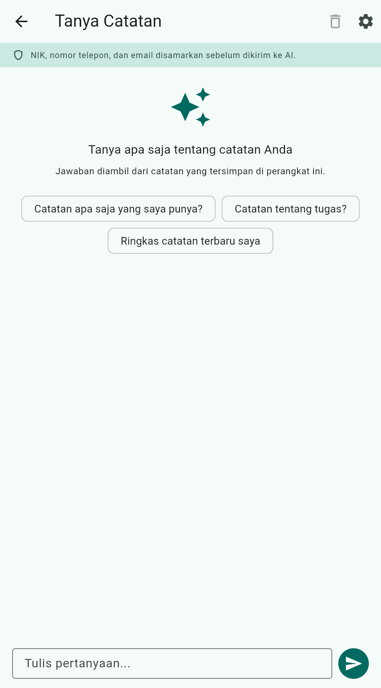
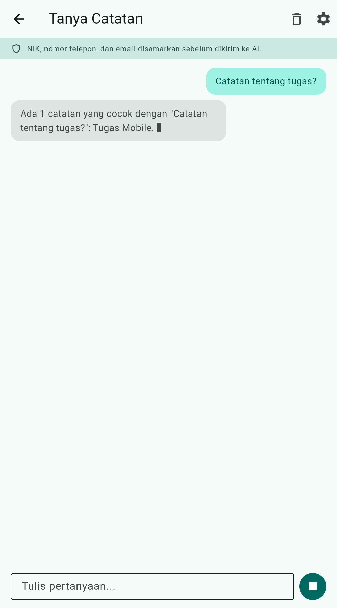
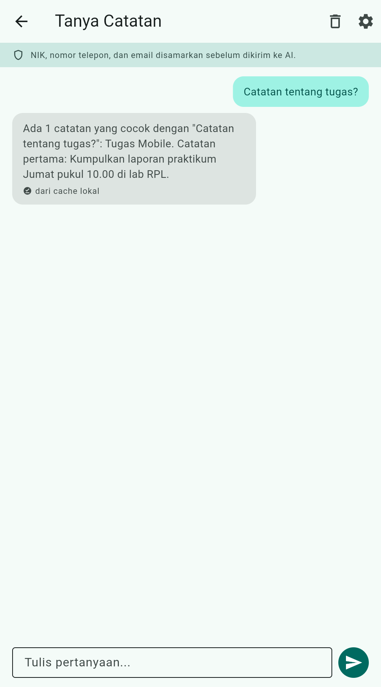
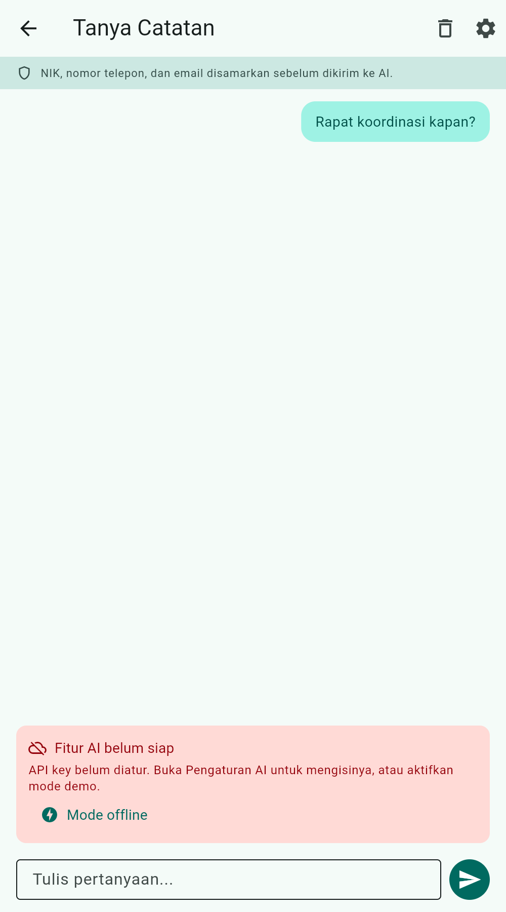

# Minggu 10 — Integrasi Fitur AI

Praktikum ini **tidak membuat project baru**. Satu fitur AI ditambahkan ke
project yang sudah dipakai sejak Minggu 5 dan lolos review Minggu 8, lalu
seluruh siklusnya diverifikasi dan didokumentasikan.

| Data | Keterangan |
|:-----|:-----------|
| Nama | Marta Prama Daniswara |
| NIM | 244107020205 |
| Kelas | TI-3D |
| Project | `05-week-5-local-storage-offline-first/week5_offline_notes` |
| Fitur | Chat asisten atas catatan + cache, kuota, dan fallback offline |
| Issue | [#20](https://github.com/artsybyte/244107020205-mobile-course/issues/20) |
| Branch | `feat/ai-chat` |

---

## Fitur yang Diintegrasikan

**Chat asisten atas catatan.** Pengguna bertanya dengan bahasa sehari-hari,
aplikasi menjawab berdasarkan judul dan isi catatan yang tersimpan di perangkat.

1. **Streaming response** — jawaban muncul bertahap (SSE), dengan tombol
   **Hentikan** dan indikator `Mengetik...`.
2. **Penyamaran data pribadi** — email, NIK 16 digit, dan nomor telepon Indonesia
   diganti penanda netral sebelum prompt dikirim.
3. **Cache lokal** — pertanyaan yang sama tidak dibayar dua kali; jawaban lama
   otomatis batal dipakai bila isi catatan berubah.
4. **Kuota harian** — maksimal 30 request/hari, dihitung sebelum request dikirim.
5. **Fallback offline** — saat AI gagal, banner menawarkan **Coba lagi** dan
   **Mode offline** (jawaban disusun dari catatan lokal).
6. **Mode demo** — aktif secara default, menjawab dari catatan lokal tanpa
   jaringan. Aplikasi bisa dijalankan dan dinilai tanpa API key pribadi.

### Hasil di layar

<table>
  <tr>
    <td align="center">
      <br>
      <b>Layar awal</b><br>
      Chip saran + pengingat privasi.
    </td>
    <td align="center">
      <br>
      <b>Streaming</b><br>
      Jawaban tumbuh bertahap, tombol berubah jadi Hentikan.
    </td>
  </tr>
  <tr>
    <td align="center">
      <br>
      <b>Cache lokal</b><br>
      Pertanyaan berulang dijawab tanpa request baru.
    </td>
    <td align="center">
      <br>
      <b>Fallback</b><br>
      Banner error + aksi Coba lagi / Mode offline.
    </td>
  </tr>
</table>

Screenshot diambil dari aplikasi yang benar-benar berjalan (`flutter build web`
+ Chrome DevTools Protocol), bukan mockup. Bukti lengkap:
[`docs/verifikasi.md`](docs/verifikasi.md).

---

## Arsitektur

```
+---------------------+        HTTPS/SSE        +--------------------+
|  AiChatPage (UI)    | <---------------------  |  Gemini API        |
|  ChatBubble         |   dio + ResponseType    |  gemini-2.5-flash  |
+----------+----------+        .stream          +--------------------+
           |
           v
+---------------------+     cache / kuota      +--------------------+
| AiChatController    | <--------------------> | SharedPreferences  |
| (Riverpod Notifier) |                        +--------------------+
+----------+----------+
           |
           v
+---------------------+     konteks catatan     +--------------------+
| PromptBuilder       | <--------------------> | notesProvider      |
| PrivacyFilter       |                        | (sqflite, Minggu 5)|
+---------------------+                        +--------------------+
```

Aturan yang dijaga:

- API key hanya dibaca dari `flutter_secure_storage`, tidak pernah ditulis ke
  kode sumber maupun `shared_preferences`.
- Widget tidak memanggil jaringan; seluruh orkestrasi ada di
  `AiChatController` dan seluruh aturan murni ada di `lib/ai/*`.
- Klien AI berada di balik `abstract AiClient`, sehingga mode demo, Gemini, dan
  klien palsu untuk test bisa ditukar tanpa menyentuh UI.

### Prompt design

| Komponen | Isi |
|:---------|:----|
| System prompt | "Kamu asisten catatan pribadi yang ramah. Jawab dalam Bahasa Indonesia dengan maksimal 2 kalimat. Jawab hanya berdasarkan konteks catatan yang diberikan. Bila konteks tidak memuat jawabannya, katakan terus terang… Jangan pernah mengarang isi catatan dan jangan menampilkan NIK, nomor telepon, atau email." |
| Konteks | Maksimal 10 catatan terbaru, isi dipotong 160 karakter per catatan |
| User prompt | Pertanyaan pengguna, dipotong 500 karakter, disamarkan dulu |
| Batas | `temperature 0.2`, `maxOutputTokens 256`, 30 request/hari |

Prompt lengkap, output draf AI, dan 12 temuan verifikasi:
[`docs/ai-log.md`](docs/ai-log.md).

---

## Tabel Risiko dan Mitigasi

| Risiko | Mitigasi di kode | Bukti |
|:-------|:-----------------|:------|
| Bocor data pengguna ke pihak ketiga | `PrivacyFilter.redact` menyamarkan email, NIK, nomor telepon sebelum prompt dibentuk | `test/ai/privacy_filter_test.dart` |
| API key bocor | Hanya di `flutter_secure_storage`; dikirim lewat header, bukan query string | `lib/ai/ai_key_store.dart`, `gemini_client.dart` |
| Biaya melonjak | Cache jawaban + kuota 30 request/hari + `maxOutputTokens` 256 | `ai_cache_test.dart`, `ai_quota_test.dart` |
| API error / down | Pesan ramah per status (401/403/404/429/5xx/timeout), tombol **Coba lagi**, **Mode offline** | `08-fallback-error.png`, `09-mode-offline.png` |
| Respons tidak relevan / mengarang | System prompt membatasi "hanya dari konteks"; fallback offline memakai pencarian kata kunci lokal, bukan generasi bebas | `local_answer_test.dart` |
| Jawaban basi setelah catatan diedit | Cache diikat ke sidik jari `jumlah@updatedAt terbaru` | `ai_cache_test.dart` |
| Data sensitif di log | Tidak ada `print` isi prompt; key tidak pernah di-log | `git grep -n "print(" -- lib/ai` → kosong |

---

## Stack Teknologi

| Lapisan | Teknologi |
|:--------|:----------|
| UI | Flutter 3.47, Material 3 |
| State | Riverpod 3 (`Notifier`, `FutureProvider`, `AsyncNotifier`) |
| HTTP/streaming | `dio` 5 (`ResponseType.stream`), parser SSE sendiri |
| Penyimpanan | `sqflite` (catatan), `shared_preferences` (cache, kuota, mode), `flutter_secure_storage` (API key) |
| Test | `flutter_test`, `ProviderContainer` override, `SharedPreferences.setMockInitialValues` |
| CI | GitHub Actions, Flutter dipin `3.47.2` |

---

## Cara Menjalankan

```bash
cd 05-week-5-local-storage-offline-first/week5_offline_notes
flutter pub get
flutter run
```

Skenario demo 3 menit:

1. Tambah catatan `Tugas Mobile`, `Belanja mingguan`, `Rapat koordinasi`.
2. Tekan ikon ✨ di AppBar → layar **Tanya Catatan**.
3. Tekan chip `Catatan tentang tugas?` → jawaban streaming dari catatan.
4. Kirim pertanyaan yang sama sekali lagi → label **dari cache lokal**.
5. Buka **Pengaturan AI** → lihat kuota dan jumlah cache.
6. Matikan **Mode demo** (tanpa mengisi key), kembali ke chat, kirim pertanyaan →
   banner **Fitur AI belum siap**; tekan **Mode offline** → jawaban dari catatan.
7. Untuk memakai Gemini asli: isi API key di Pengaturan AI, matikan mode demo.

### Bukti mesin hijau

```bash
flutter analyze
# Analyzing week5_offline_notes...
# No issues found! (ran in 2.2s)

dart format --output=none --set-exit-if-changed lib test
# Formatted 56 files (0 changed) in 0.07 seconds.
# exit code 0

flutter test
# 00:02 +95: All tests passed!

flutter build web --release
# √ Built build\web
```

---

## Struktur Folder

```
10-week-10-ai-feature-integration/
├── README.md                       # dokumen ini
├── lib/                            # salinan berkas fitur (sumber kanonik di week5)
│   ├── ai/
│   │   ├── ai_config.dart          # model, endpoint, batas biaya
│   │   ├── ai_client.dart          # kontrak + AiException
│   │   ├── gemini_client.dart      # Gemini SSE via dio
│   │   ├── demo_client.dart        # klien tanpa jaringan
│   │   ├── sse_parser.dart         # parser Server-Sent Events
│   │   ├── prompt_builder.dart     # system prompt + konteks
│   │   ├── privacy_filter.dart     # penyamaran email/NIK/telepon
│   │   ├── local_answer.dart       # jawaban dari data lokal
│   │   ├── ai_cache.dart           # cache + sidik jari catatan
│   │   ├── ai_quota.dart           # batas request harian
│   │   ├── ai_key_store.dart       # secure storage API key
│   │   ├── ai_settings.dart        # preferensi mode demo
│   │   ├── ai_chat_controller.dart # orkestrasi chat
│   │   ├── chat_message.dart       # model pesan
│   │   └── ai_providers.dart       # wiring Riverpod
│   ├── pages/
│   │   ├── ai_chat_page.dart
│   │   ├── settings_page.dart
│   │   └── notes_page.dart
│   └── widgets/
│       └── chat_bubble.dart
├── docs/
│   ├── ai-log.md                   # prompt, output draf, 12 temuan verifikasi
│   └── verifikasi.md               # keluaran analyze/format/test/build + uji manual
└── screenshots/
    ├── 01-daftar-catatan.png
    ├── 02-chat-kosong.png
    ├── 03-jawaban-streaming.png
    ├── 04-jawaban-lengkap.png
    ├── 05-jawaban-cache.png
    ├── 06-pengaturan-ai.png
    ├── 07-pengaturan-tanpa-key.png
    ├── 08-fallback-error.png
    └── 09-mode-offline.png
```

> **Catatan soal `lib/`:** isi folder ini adalah **salinan** dari berkas yang
> benar-benar dipakai aplikasi. Sumber kanonik tetap di
> `05-week-5-local-storage-offline-first/week5_offline_notes/` (branch
> `feat/ai-chat`). Salinan dibuat agar folder portofolio minggu 10 bisa dibaca
> berdiri sendiri.

---

## Penyimpangan dari Codelab (dan alasannya)

| Codelab | Implementasi | Alasan |
|:--------|:-------------|:-------|
| `http: ^1.2.0` | `dio ^5.9.0` (sudah ada) | Streaming SSE butuh `ResponseBody.stream`; menambah `http` berarti dua klien HTTP |
| `gemini-pro` | `gemini-2.5-flash` | `gemini-pro` tidak dilayani `v1beta` (404) |
| `flutter_secure_storage: ^9.0.0` | `^11.2.0` | Versi terbaru; `^9` tidak kompatibel dengan toolchain saat ini |
| API key di query `?key=` | Header `x-goog-api-key` | Key tidak ikut tercatat di URL/log proxy |
| `riverpod: ^2.5.0` | `flutter_riverpod ^3.4.3` (sudah ada) | Project sudah Riverpod 3; menurunkan versi akan merusak kode Minggu 5–9 |
| Dialog "Layanan AI Sibuk" | Banner + dua tombol aksi | Dialog menutupi jawaban terakhir dan memaksa dua keputusan berurutan |

---

## Refleksi

### 1) Fitur AI mana yang diintegrasikan dan mengapa

Chat asisten atas catatan. Alasannya bukan karena paling mudah, tetapi karena
paling dekat dengan data yang sudah dimiliki aplikasi: catatan lokal. Dengan
begitu nilai fitur bisa diukur — jawaban benar-benar berasal dari catatan
pengguna, dan ketika AI gagal, aplikasi masih bisa menjawab dari sumber yang
sama. Fitur OCR atau Speech-to-Text akan menambah izin kamera/mikrofon dan
ketergantungan platform tanpa menambah kejelasan arsitektur.

### 2) Bagaimana privasi pengguna dilindungi

Tiga lapis. Pertama, data pribadi disamarkan di satu fungsi murni
(`PrivacyFilter`) sebelum prompt dibentuk, sehingga tidak ada jalur lain yang
bisa melewatinya. Kedua, yang dikirim hanya judul + potongan isi (160 karakter,
maksimal 10 catatan), bukan seluruh database. Ketiga, API key tidak pernah
menyentuh kode sumber: hanya secure storage, dan dikirim lewat header.

Yang saya sadari saat mengerjakan: menyamarkan teks tidak cukup kalau polanya
salah. Regex versi pertama hanya mengenali nomor seluler, sehingga nomor rumah
`+62341234567` lolos. Test yang menangkapnya, bukan pembacaan kode.

### 3) Fallback saat layanan AI error

Berlapis menurut biaya. Pertama cache lokal: pertanyaan berulang tidak menyentuh
jaringan sama sekali. Kedua kuota: kalau habis, aplikasi berhenti sebelum
request, bukan sesudah tagihan. Ketiga, saat jaringan gagal, banner menawarkan
**Coba lagi** (untuk error yang bisa pulih) dan **Mode offline** yang menyusun
jawaban dari catatan lokal dengan pencarian kata kunci — sumber yang sama
dengan yang dipakai mode demo, jadi tidak ada jalur "mengarang" terpisah.

### 4) Satu hal yang dipelajari tentang UX fitur AI di mobile

Streaming mengubah persepsi kecepatan lebih besar daripada optimasi latensi.
Pada mode demo, jawaban yang sama tetap terasa lebih responsif ketika muncul
bertahap dibanding muncul sekaligus — padahal total waktunya identik. Karena
itu tombol berubah menjadi **Hentikan** selama streaming: pengguna harus bisa
menghentikan sesuatu yang terlihat sedang berjalan.

### 5) Hal yang paling mengejutkan saat verifikasi

`FutureProvider` Riverpod 3 mengulang provider yang gagal dengan backoff
eksponensial secara default. Akibatnya, ketika API key belum ada, layar chat
berhenti di keadaan "mengirim" dan banner error tidak pernah muncul — bukan
bug di UI, tetapi perilaku framework. Ini hanya terlihat karena aplikasi
dijalankan sungguhan dan di-screenshot, tidak akan tertangkap oleh test yang
memakai klien palsu. Perbaikannya satu baris (`retry: (_, _) => null`), tetapi
tanpa menjalankan aplikasi saya akan melaporkan fitur ini "selesai" padahal
jalur error-nya mati.
